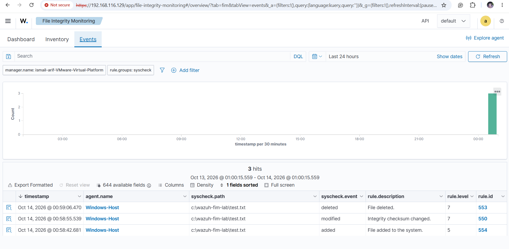

# 🛡️ Wazuh SIEM Homelab

### Security Information and Event Management | Endpoint Monitoring | File Integrity Monitoring

A hands-on cybersecurity homelab project focused on deploying and configuring **Wazuh SIEM** to monitor Windows endpoints, collect security events, detect file integrity changes, and investigate security alerts.

This project demonstrates practical experience in **Security Operations Center (SOC) fundamentals, SIEM administration, endpoint monitoring, log analysis, and threat detection**.

---

## 📌 Project Overview

The objective of this project is to build a functional Security Information and Event Management (SIEM) environment using Wazuh.

The lab consists of an Ubuntu virtual machine running the Wazuh SIEM platform and a Windows 11 host configured with the Wazuh Agent.

The Windows endpoint communicates with the Wazuh Manager, allowing security-related activities to be monitored and analyzed through a centralized dashboard.

### Project Objectives

- Deploy a Wazuh SIEM server in a virtualized environment.
- Configure and manage Windows endpoint monitoring.
- Establish communication between Wazuh Manager and Wazuh Agent.
- Implement File Integrity Monitoring (FIM).
- Detect file creation, modification, and deletion activities.
- Investigate security alerts and analyze event logs.
- Document technical configurations and detection results.

---

## 🏗️ Lab Architecture

```text
             WINDOWS 11 HOST
        +------------------------+
        |                        |
        |      Wazuh Agent       |
        |                        |
        |  File Integrity        |
        |  Monitoring (FIM)      |
        |                        |
        +-----------+------------+
                    |
                    | TCP 1514 / 1515
                    |
        +-----------v------------+
        |                        |
        |    VMware Workstation  |
        |                        |
        |   Ubuntu 24.04.5 LTS   |
        |                        |
        |     Wazuh Manager      |
        |     Wazuh Indexer      |
        |     Filebeat           |
        |     Wazuh Dashboard    |
        |                        |
        +------------------------+
```

**Architecture Explanation:**

1. The Windows 11 endpoint runs the Wazuh Agent.
2. The Wazuh Agent collects endpoint security information and monitors configured directories.
3. The agent communicates with the Wazuh Manager hosted on Ubuntu.
4. The Wazuh platform processes and stores security events.
5. Security alerts and monitoring results are reviewed through the Wazuh Dashboard.

---

## 🛠️ Technologies & Tools

| Technology | Purpose |
|---|---|
| Wazuh SIEM 4.14.8 | Security monitoring and event analysis |
| Ubuntu 24.04.5 LTS | Wazuh server operating system |
| Windows 11 | Monitored endpoint |
| VMware Workstation | Virtualization environment |
| Wazuh Agent | Endpoint monitoring and log collection |
| Windows PowerShell | Agent installation, configuration, and testing |
| File Integrity Monitoring | Detection of file system changes |
| GitHub | Technical documentation and project portfolio |

---

## 🚀 Project Implementation

### Phase 1 — Virtual Machine Setup

Configured an Ubuntu Linux virtual machine using VMware Workstation.

**Activities:**
- Installed Ubuntu 24.04.5 LTS.
- Configured virtual machine resources.
- Verified network connectivity.
- Prepared the environment for Wazuh installation.

### Phase 2 — Wazuh SIEM Deployment

Deployed Wazuh SIEM on the Ubuntu virtual machine.

**Components installed:**
- Wazuh Manager
- Wazuh Indexer
- Filebeat
- Wazuh Dashboard

The deployment established a centralized security monitoring environment.

### Phase 3 — Windows Agent Deployment

Installed and configured the Wazuh Agent on the Windows 11 host.

**Activities:**
- Verified connectivity through TCP ports 1514 and 1515.
- Installed the Wazuh Agent using PowerShell.
- Configured the Wazuh Manager connection.
- Verified the Windows Agent service.
- Confirmed the endpoint displayed an **Active** status in the Wazuh Dashboard.

**Deployment Result:**

| Field | Result |
|---|---|
| Agent Name | Windows-Host |
| Agent ID | 001 |
| Operating System | Windows 11 |
| Agent Version | 4.14.8 |
| Connection Status | Active |

### Phase 4 — File Integrity Monitoring (FIM)

Implemented File Integrity Monitoring on the Windows endpoint to identify changes within a designated testing directory.

**Monitored Directory:**

`C:\Wazuh-FIM-Lab`

**FIM Configuration:**

```xml
<directories realtime="yes" check_all="yes">C:\Wazuh-FIM-Lab</directories>
```

**Detection Scenarios:**

| Test Case | Activity | Detection |
|---|---|---|
| Test 1 | File Creation | Detected |
| Test 2 | File Modification | Detected |
| Test 3 | File Deletion | Detected |

The Wazuh FIM Dashboard displayed three file integrity events categorized as added, modified, and deleted.

These tests were conducted in a controlled lab environment to validate endpoint monitoring capabilities.

**Detailed Documentation:**

[File Integrity Monitoring Lab](docs/03-file-integrity-monitoring.md)

---

## 📊 Detection Results

### File Integrity Monitoring

The Wazuh Dashboard recorded file integrity events generated during the monitoring experiment.

The detected activities included:

- **Added:** A new file was created in the monitored directory.
- **Modified:** The monitored file content was changed.
- **Deleted:** The monitored file was removed.

The dashboard displayed a total of three events across these categories.

### Detection Dashboard



The screenshot provides evidence of the file integrity monitoring experiment conducted on the Windows endpoint.

---

## 🔍 Security Analysis

The File Integrity Monitoring experiment demonstrates how Wazuh can support security analysts in identifying changes to monitored files.

Such monitoring may help identify:

- Unauthorized file modifications.
- Unexpected changes to configuration files.
- Suspicious file creation.
- Deletion of monitored files.
- Potential indicators of system tampering.

**Note:** The activities performed in this project were authorized lab simulations. Detection of a file change does not necessarily indicate malicious activity.

---

## 📁 Repository Structure

```text
Wazuh-SIEM-Homelab/
|
|-- README.md
|
|-- docs/
|   |-- 03-file-integrity-monitoring.md
|   |-- Additional lab documentation
|
|-- screenshots/
|   |-- after-detection.png
|   |-- Additional evidence screenshots
```

The `docs` directory contains technical documentation, while the `screenshots` directory stores supporting evidence from the lab environment.

---

## 🧠 Skills Demonstrated

**Security Operations & Monitoring**
- SIEM Deployment and Administration
- Endpoint Security Monitoring
- Security Event Collection
- File Integrity Monitoring
- Security Alert Investigation

**System & Network Administration**
- Linux System Administration
- Windows PowerShell
- Virtual Machine Configuration
- TCP/IP Connectivity Troubleshooting
- Windows Service Management

**Technical Documentation**
- Cybersecurity Lab Documentation
- Detection Testing
- Evidence Collection
- GitHub Project Management

---

## 📈 Future Improvements

The following enhancements are planned to expand the homelab:

- [x] Ubuntu virtual machine setup
- [x] Wazuh SIEM installation
- [x] Windows Agent deployment
- [x] File Integrity Monitoring
- [ ] Detailed security alert investigation
- [ ] Windows failed login detection
- [ ] Custom Wazuh detection rules
- [ ] Security incident analysis report
- [ ] Additional endpoint security use cases

---

## 🎯 Project Outcome

Successfully deployed a Wazuh SIEM homelab integrating an Ubuntu-based Wazuh server with a Windows 11 endpoint.

The environment demonstrated centralized endpoint monitoring and the detection of file creation, modification, and deletion activities.

This project provides a practical foundation for developing skills in **SOC operations, SIEM monitoring, security alert analysis, and defensive cybersecurity**.

---

## 📚 References

- [Wazuh Official Website](https://wazuh.com/)
- [Wazuh Documentation](https://documentation.wazuh.com/current/)
- [MITRE ATT&CK Framework](https://attack.mitre.org/)

---

**Project Type:** Cybersecurity Homelab  
**Focus Area:** Blue Team / Security Operations Center (SOC)  
**Platform:** Wazuh SIEM  
**Environment:** Windows 11 + Ubuntu Linux + VMware Workstation
