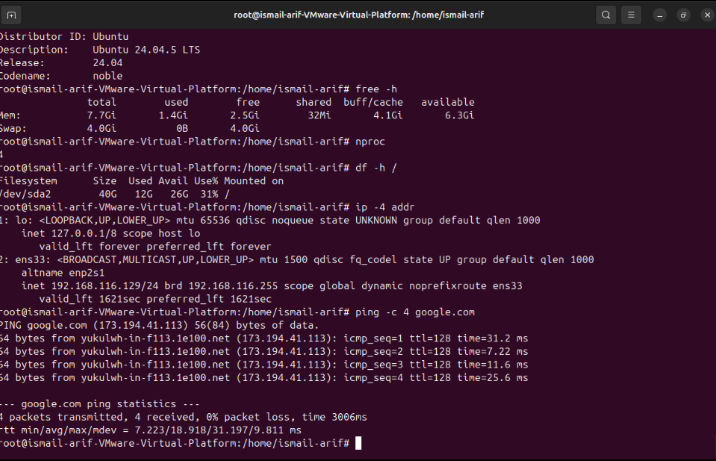

## Ubuntu System Verification

### Objective
To verify the operating system, hardware resources, disk capacity, and network connectivity before deploying Wazuh SIEM.

### Verification Commands

```bash
lsb_release -a
free -h
nproc
df -h /
ip -4 addr
ping -c 4 google.com
```

### System Specifications

| Component | Details |
|---|---|
| Operating System | Ubuntu 24.04.5 LTS |
| Virtualization | VMware Workstation |
| CPU | 4 vCPU |
| RAM | 7.7 GiB |
| Swap | 4.0 GiB |
| Root Filesystem | 40 GB |
| Available Storage | 26 GB |
| Network Interface | ens33 |
| Network Connectivity | Successful |

### Network Connectivity Test

The Ubuntu virtual machine successfully communicated with Google's public server.

**Results:**
- Packets transmitted: 4
- Packets received: 4
- Packet loss: 0%
- Average latency: 18.918 ms

### Verification Screenshot



### Findings

The Ubuntu virtual machine is operational, with sufficient CPU and approximately 8 GiB of RAM allocated.

Network connectivity was successfully verified. However, the current 40 GB root filesystem is below the recommended storage capacity for the planned Wazuh all-in-one deployment.


