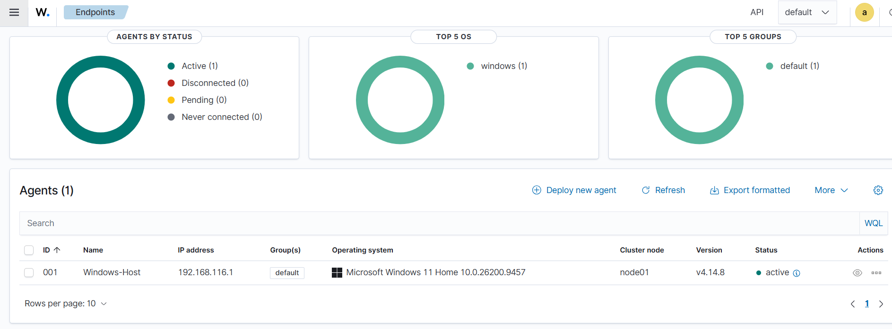

# Phase 2: Windows Wazuh Agent Deployment

## 1. Overview

This phase focuses on deploying and configuring the Wazuh Agent on a Windows endpoint to establish centralized security monitoring through the Wazuh Manager hosted on an Ubuntu Linux virtual machine.

The Wazuh Agent collects security-related information from the Windows endpoint and forwards it to the Wazuh Manager for analysis and monitoring.

## 2. Objectives

- Install the Wazuh Agent on a Windows endpoint.
- Establish communication between the Windows Agent and Ubuntu Wazuh Manager.
- Verify network connectivity and agent service status.
- Confirm successful agent registration through the Wazuh Dashboard.
- Prepare the Windows endpoint for File Integrity Monitoring (FIM).

## 3. Lab Environment

| Component | Specification |
|---|---|
| Host Operating System | Windows |
| Virtualization Platform | VMware Workstation |
| Wazuh Server OS | Ubuntu 24.04.5 LTS |
| Wazuh Manager Version | 4.14.8 |
| Wazuh Agent Version | 4.14.8 |
| Agent Name | Windows-Host |
| Network Configuration | VMware NAT |
| Agent Communication | TCP 1514 |
| Agent Enrollment | TCP 1515 |

## 4. Network Connectivity Verification

Before installing the Wazuh Agent, connectivity between the Windows endpoint and the Ubuntu Wazuh Manager was tested using Windows PowerShell.

The following commands were executed:

```powershell
Test-NetConnection 192.168.116.129 -Port 1514
Test-NetConnection 192.168.116.129 -Port 1515
```

### Results

Both connectivity tests returned:

```text
TcpTestSucceeded : True
```

This confirmed that the Windows endpoint could reach the Wazuh Manager through the required communication and enrollment ports.

## 5. Wazuh Agent Installation

### Step 1: Download the Installer

Windows PowerShell was opened with administrator privileges.

The Wazuh Agent MSI installer was downloaded using:

```powershell
Invoke-WebRequest -Uri "https://packages.wazuh.com/4.x/windows/wazuh-agent-4.14.8-1.msi" -OutFile "$env:TEMP\wazuh-agent.msi"
```

### Step 2: Install the Wazuh Agent

The Wazuh Agent was configured to communicate with the Ubuntu Wazuh Manager.

```powershell
$managerIP = "192.168.116.129"

$process = Start-Process msiexec.exe -Wait -PassThru -ArgumentList @(
    '/i'
    "`"$env:TEMP\wazuh-agent.msi`""
    '/qn'
    "WAZUH_MANAGER=$managerIP"
    'WAZUH_AGENT_NAME=Windows-Host'
)

$process.ExitCode
```

The installation uses the Windows MSI installer and specifies the Wazuh Manager address and agent name.

## 6. Wazuh Agent Service Verification

After installation, the Wazuh Agent service can be started and verified using:

```powershell
Start-Service WazuhSvc
Get-Service WazuhSvc
```

### Expected Result

```text
Status    Name       DisplayName
------    ----       -----------
Running   WazuhSvc   Wazuh
```

A running service indicates that the Wazuh Agent process is active on the Windows endpoint.

## 7. Wazuh Dashboard Verification

The Wazuh Dashboard is accessed through the Ubuntu Wazuh Manager's IP address.

The agent connection status is checked under:

**Agents Management → Summary**

Expected agent information:

| Field | Expected Value |
|---|---|
| Agent Name | Windows-Host |
| Operating System | Windows |
| Connection Status | Active |
| Wazuh Manager | Ubuntu Linux |

**Actual connection status:** Pending confirmation.

## 8. Screenshots

The following screenshots will be added after successful verification.

### Windows Agent Dashboard



## 9. Troubleshooting

If the Windows Agent does not connect to the Wazuh Manager, the following checks can be performed:

1. Verify that the Wazuh Manager service is running.
2. Confirm connectivity through TCP ports 1514 and 1515.
3. Verify that the Wazuh Agent service is running.
4. Confirm the configured Wazuh Manager IP address.
5. Review the Wazuh Agent logs for connection or enrollment errors.

The agent logs can be inspected using:

```powershell
Get-Content "C:\Program Files (x86)\ossec-agent\ossec.log" -Tail 30
```

## 10. Learning Outcomes

This phase is intended to develop practical knowledge of:

- Windows endpoint security monitoring.
- Wazuh Agent deployment and configuration.
- Client-server communication in a SIEM environment.
- Network connectivity verification.
- Basic endpoint troubleshooting.

## 11. Next Phase

**Phase 3: File Integrity Monitoring (FIM)**

The next phase will focus on configuring File Integrity Monitoring on the Windows endpoint to detect file creation, modification, and deletion activities.

