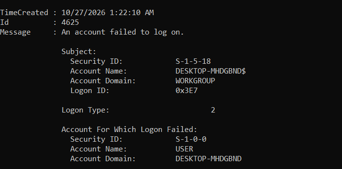
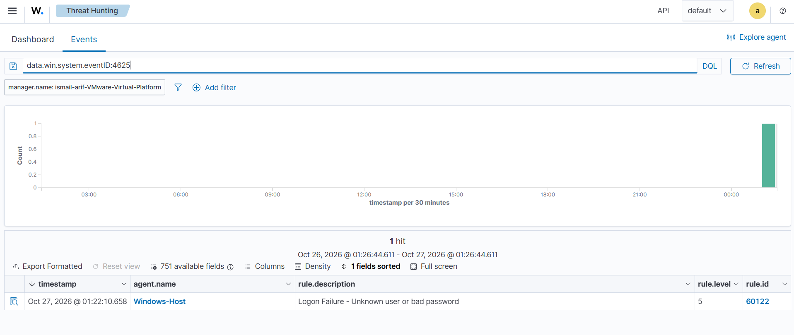
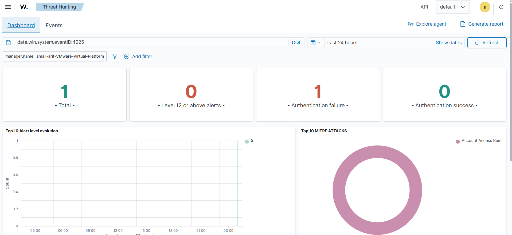

# Phase 4: Windows Failed Login Detection Using Wazuh SIEM

## 1. Overview

This lab demonstrates centralized detection of a controlled failed Windows 11 login using Wazuh SIEM. A Windows Security Event ID **4625** was generated and detected by the Wazuh Manager through the Windows endpoint agent.

## 2. Objectives

- Verify Windows logon auditing for failed authentication.
- Verify Windows Security log collection in the Wazuh Agent.
- Generate and identify a controlled Event ID 4625.
- Confirm detection and investigate the alert in Wazuh Threat Hunting.
- Record evidence and findings for a cybersecurity portfolio.

## 3. Lab Environment

| Component | Details |
|---|---|
| SIEM | Wazuh 4.14.8 |
| Server | Ubuntu 24.04.5 LTS, VMware Workstation |
| Endpoint | Windows 11 |
| Agent | Windows-Host (ID 001), Wazuh Agent 4.14.8 |
| Detection | Windows Security Event ID 4625 |

## 4. Verify Windows Logon Auditing

Run in **Windows PowerShell as Administrator**:

```powershell
auditpol /get /subcategory:"Logon"
```

Observed setting: **Success and Failure**. Windows was configured to audit failed logons.

## 5. Verify Wazuh Security Event Collection

The Windows Wazuh Agent configuration at `C:\Program Files (x86)\ossec-agent\ossec.conf` contained a `localfile` section collecting the `Security` event channel with `eventchannel` format. Its query did **not** exclude Event ID 4625.

```xml
<localfile>
  <location>Security</location>
  <log_format>eventchannel</log_format>
  <!-- The existing configuration also contains an event-filter query. -->
</localfile>
```

The snippet above is abbreviated for documentation; it is not a replacement for the full configuration file.

## 6. Controlled Failed Login Test

One intentionally incorrect password was entered on an authorized Windows account to generate a failed interactive logon. The following command was used to inspect the Windows Security log:

```powershell
Get-WinEvent -FilterHashtable @{
    LogName = 'Security'
    Id = 4625
    StartTime = (Get-Date).AddMinutes(-15)
} -MaxEvents 5 | Format-List TimeCreated, Id, Message
```

**Observed Windows evidence:**

| Field | Result |
|---|---|
| Event ID | 4625 |
| Message | An account failed to log on |
| Logon type | 2 (interactive) |
| Target account | USER |
| Event time | 27 October 2026, 01:22:10 AM (local time) |



## 7. Wazuh Threat Hunting Detection

In Wazuh **Threat Hunting → Events**, the query below returned a matching alert:

```text
data.win.system.eventID:4625
```

| Alert field | Observed value |
|---|---|
| Agent | Windows-Host |
| Rule ID | 60122 |
| Rule level | 5 |
| Rule description | Logon Failure - Unknown user or bad password |
| Matching events | 1 |
| Detection | Successful |



### Threat Hunting Dashboard

With the Event ID 4625 filter applied, the dashboard displayed **1 total alert**, **1 authentication failure**, **0 authentication successes**, and **0 level-12-or-above alerts**. These counts apply only to the selected query and time range.



## 8. SOC Investigation and Interpretation

**What happened?** An unsuccessful interactive login occurred on the Windows endpoint. Windows recorded Event ID 4625, which was collected by the Wazuh Agent and matched Wazuh Rule 60122.

**Why does it matter?** Authentication failures can be useful for identifying credential errors, unauthorized access attempts, and suspicious repeated login activity. However, a single failure alone does not prove an attack.

**Assessment:** This was an authorized lab simulation. The available evidence confirms collection and alerting, not malicious activity or compromise. No source IP or additional event detail is asserted without verification.

## 9. Learning Outcomes

- Windows Security auditing and Event ID 4625 interpretation
- Windows Event Channel collection using Wazuh Agent
- Wazuh Threat Hunting filtering and rule analysis
- Basic SOC evidence collection and documentation

## 10. Next Steps

- Expand the alert and examine available account, logon type, source address, and timestamp fields.
- Test repeated failures on an authorized test account without triggering lockouts.
- Develop and validate a custom Wazuh detection rule.

## Project Status

**Phase 4: Completed — Windows failed-login event successfully detected by Wazuh.**
