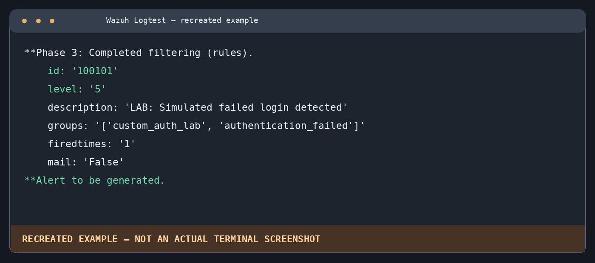
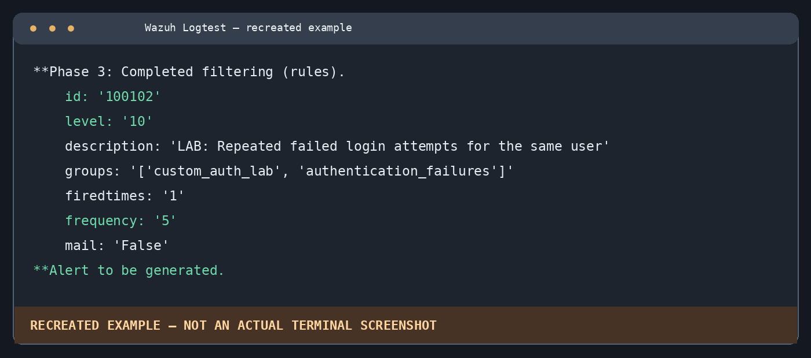

# Phase 5 — Custom Wazuh Detection Rules

## Objective
Create and validate custom Wazuh detection rules for individual simulated authentication failures and repeated failed-login events associated with the same username.

## Environment
- Wazuh Manager, Indexer and Dashboard: Ubuntu 24.04 VM (Wazuh 4.14.8)
- Windows 11 endpoint with Wazuh Agent
- Testing tool: `/var/ossec/bin/wazuh-logtest`
- Rules file: `/var/ossec/etc/rules/local_rules.xml`

## Detection logic

| Rule ID | Purpose | Level | Status |
|---|---|---:|---|
| `100100` | Correlate genuine Windows failed-logon alerts (`60122`) by target username | 10 | Configured; end-to-end validation pending |
| `100101` | Detect a simulated failed-login JSON event | 5 | **Passed** in `wazuh-logtest` |
| `100102` | Correlate five simulated failed logins for the same username within 120 seconds | 10 | **Passed** in `wazuh-logtest` |

The lab rules use the built-in `json` decoder. They are intentionally separate from the Windows EventChannel rule because pasting a Windows event JSON object into `wazuh-logtest` decoded it as `json`, not `windows_eventchannel`.

## Configuration

See [`../rules/phase5_custom_rules.xml`](../rules/phase5_custom_rules.xml). These are rule **snippets**, intended to be added to the existing `/var/ossec/etc/rules/local_rules.xml`; **do not overwrite** the file or remove its existing rules.

Backup before editing:

```bash
sudo cp /var/ossec/etc/rules/local_rules.xml /var/ossec/etc/rules/local_rules.xml.bak
sudo nano /var/ossec/etc/rules/local_rules.xml
```

Validate:

```bash
sudo /var/ossec/bin/wazuh-analysisd -t
echo $?
```

Observed result: `0` (validation successful).

For production use of modified rules, restart the manager during an appropriate maintenance window:

```bash
sudo systemctl restart wazuh-manager
sudo systemctl status wazuh-manager
```

## Test 1 — Single simulated failed login

Start a Logtest session:

```bash
sudo /var/ossec/bin/wazuh-logtest
```

Enter this JSON as one line:

```json
{"lab":{"event":"failed_login","username":"LabUser"}}
```

**Observed result:**

```text
**Phase 3: Completed filtering (rules).
    id: '100101'
    level: '5'
    description: 'LAB: Simulated failed login detected'
    groups: '['custom_auth_lab', 'authentication_failed']'
    firedtimes: '1'
    mail: 'False'
**Alert to be generated.
```

**Result: PASS.**

## Test 2 — Repeated simulated failed logins

Within the **same** `wazuh-logtest` session, submit the same JSON event repeatedly, using the same username and keeping the events within 120 seconds.

**Observed result:**

```text
**Phase 3: Completed filtering (rules).
    id: '100102'
    level: '10'
    description: 'LAB: Repeated failed login attempts for the same user'
    groups: '['custom_auth_lab', 'authentication_failures']'
    firedtimes: '1'
    frequency: '5'
    mail: 'False'
**Alert to be generated.
```

**Result: PASS.** The observed correlation rule fired with `frequency: '5'`.

## Scope and limitations

- **Confirmed:** simulated JSON detection and repeated-event correlation in `wazuh-logtest`.
- **Not yet confirmed:** end-to-end firing of rule `100100` from real Windows Security Event ID `4625` events via the Windows Agent.
- A `wazuh-logtest` alert does **not** automatically prove that the alert appeared in the Wazuh Dashboard or was ingested by the manager from an endpoint.
- The sample username `LabUser` is synthetic. Do not publish real credentials or private security logs.
- A level 10 alert in this exercise indicates a custom lab correlation threshold, not proof of a real brute-force attack.

## Recreated result illustrations

The following visuals are **recreated from the reported test output**. They are **not authentic terminal screenshots** and should not be presented as independent evidence of execution. Replace with real captures when available.

**Single simulated failed login — Rule 100101, Level 5**



**Repeated simulated failed logins — Rule 100102, Level 10**



## Skills demonstrated

- SIEM rule development using Wazuh XML syntax
- JSON log parsing and field matching
- Stateful event correlation (`frequency`, `timeframe`, `same_field`)
- Detection validation with `wazuh-analysisd -t` and `wazuh-logtest`
- Distinguishing synthetic rule tests from live endpoint telemetry

## Next step

Validate the production Windows EventChannel correlation rule (`100100`) using authorized, controlled endpoint testing and document its real Wazuh alert evidence separately.
